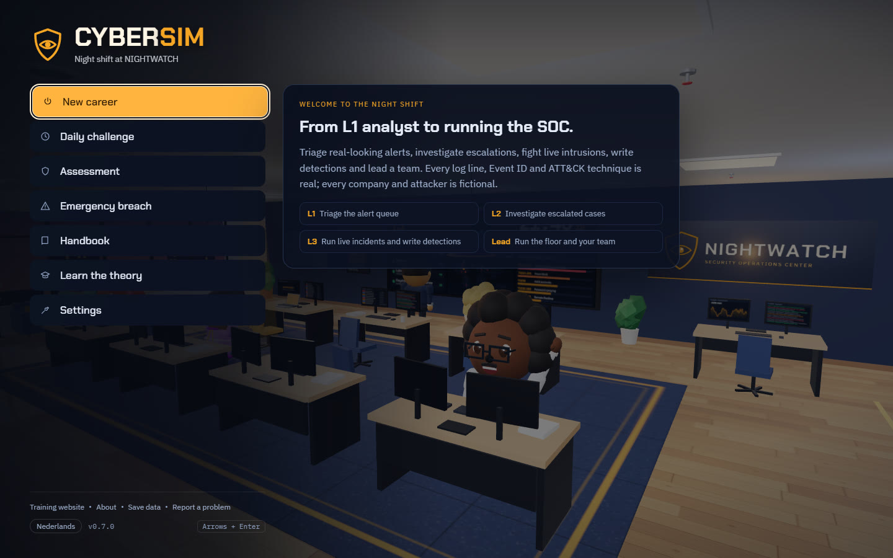
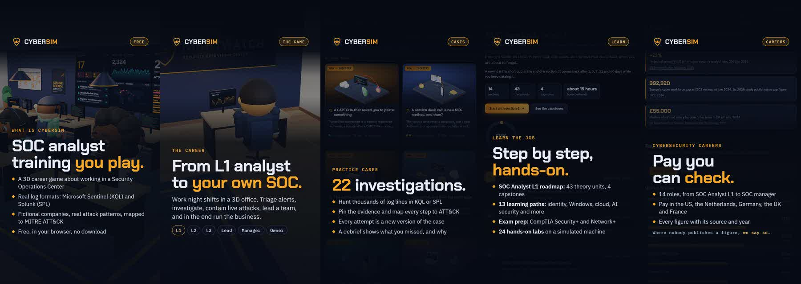
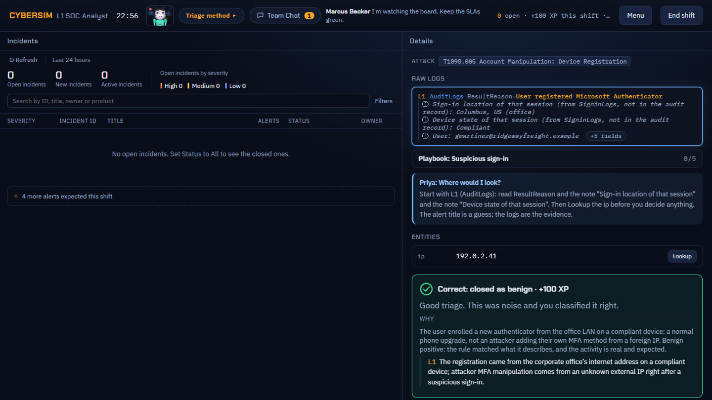
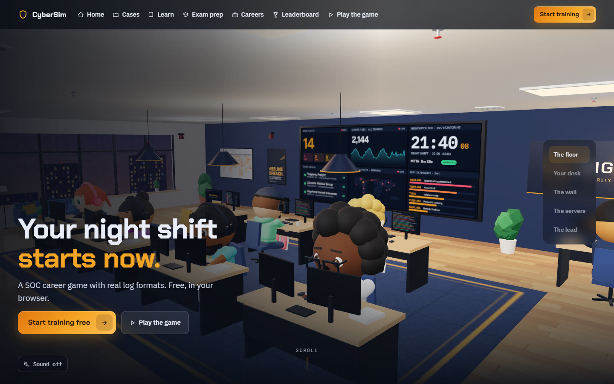

# CyberSim

**A SOC career game you play in the browser.** You start as an L1 analyst on the night shift at Nightwatch, a fictional security operations center, and work your way up to running the whole SOC.

Play it free: **[www.playcybersim.com](https://www.playcybersim.com)**

This repository is a showcase. The source code is private.

## Watch

Click the image for a 40-second tour (vertical video).

## Why I built it

Most SOC training is either slides or a sandbox without context. I wanted to show what the job actually feels like: a queue that never empties, real log formats, attacks hidden in the noise, and decisions that have consequences the next night. CyberSim is that job turned into a game, with every technique mapped to MITRE ATT&CK.

## The career

| Rank | What you do |
|---|---|
| **L1 SOC Analyst** | Triage the incident queue: close as true positive, benign or false positive with a comment, escalate, or contain (isolate a host, disable a user, revoke sessions, block an IP). Multi-stage attacks run through the noise; miss the chain and the night can end in ransomware. |
| **L2 SOC Analyst** | Investigate escalated cases: hunt in **KQL or SPL**, pin evidence on a timeline, find initial access, scope, ATT&CK techniques and the right response. Call the client when you need context. |
| **L3 / Incident Responder** | Fight a live intrusion in the war room, triage malware, then write a detection rule and deploy it. |
| **SOC Lead** | Plan the night: assign work to a team with skills, traits, fatigue and morale, and review their mistakes. |
| **SOC Manager / Owner** | Run the SOC as a business: contracts, hiring, tooling, SLAs, MTTD and MTTR, client satisfaction and cash. Bankruptcy is possible. |

Promotion takes XP, accuracy over time, shifts at your rank and a certification exam.

## Built to be realistic

- **Three SIEM consoles**, modelled on Microsoft Sentinel, the Microsoft Defender portal and Splunk Enterprise Security, with real table and column names and real Windows event IDs. One attack is written once and shown in each tool's own format.
- **A real query engine** for the common subset of KQL and SPL, so you hunt with the same syntax you use at work.
- **MITRE ATT&CK** on every case, plus a Threat Codex where each technique unlocks when you meet it in real work.
- **Cases based on 2025-2026 attacks**: help-desk MFA resets, ClickFix, remote-access tools abused for persistence, a supply-chain npm worm, an exploited VPN appliance.
- **A story** across three SOCs, with a recurring threat group and a best friend who turns rival.

## The website around it

- Practice cases that run on the game's own engine, with a fresh version of the case on every attempt and a debrief that shows what you missed and why.
- Learning paths: an SOC Analyst L1 roadmap, a Level 2 roadmap, GRC, plus exam prep for CompTIA Security+ and Network+.
- Profiles, daily quests, streaks and a leaderboard, built to keep people coming back without guilt mechanics.

## Assessment for trainers

Scores are recomputed on the server from the player's decisions, never taken from the browser, and every result is signed with Ed25519 so a trainer can verify it. Trainers can issue official L1 or L2 assessments with a server-held clock and one submission per invite.

## Tech

TypeScript, Vite, Three.js (3D office and characters), a custom KQL/SPL interpreter, Supabase (accounts and a Deno edge function for scoring), Vercel. Tested with Vitest and Playwright, including accessibility checks with axe.

## Status

Public beta. All companies, people and domains in the game are fictional; attacker IPs use documentation ranges.

---

Made by [Stefano van Tongeren](https://github.com/STongeren) · [LinkedIn](https://www.linkedin.com/in/stongeren/)
